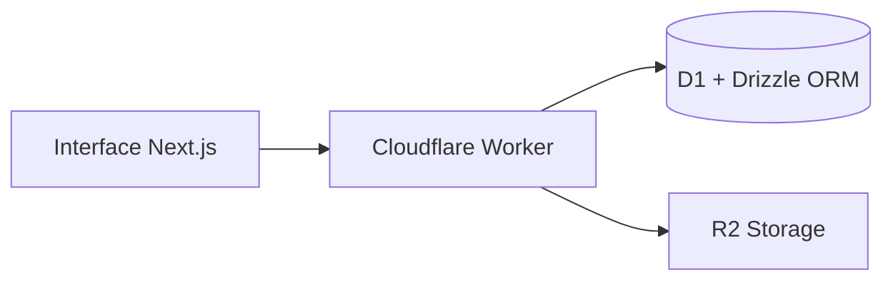

<div align="center">

# 🔑 Chave Direta

### Encontre. Negocie. Conquiste. É seu.

Plataforma acadêmica para busca, anúncio, locação e compra de imóveis, com uma jornada digital mais clara, segura e organizada.

[](https://santosingridia.github.io/chave-direta/)
[](https://chave-direta.diasingrid56.chatgpt.site/)
[](#projeto-acadêmico)

[Apresentação](https://santosingridia.github.io/chave-direta/) · [Sistema completo](https://chave-direta.diasingrid56.chatgpt.site/) · [Documentação](docs/ARQUITETURA.md)

</div>

---

## Sobre o projeto

O **Chave Direta** conecta pessoas interessadas em imóveis a proprietários e anunciantes. A plataforma reúne descoberta, comparação, anúncio, agendamento, simulação e negociação em uma única experiência.

O projeto começou com foco em locação residencial e evoluiu para contemplar também **compra e venda**, diferentes modalidades de aquisição, garantias, áreas privadas e acompanhamento das etapas da negociação.

> **Aviso:** esta é uma demonstração acadêmica. A plataforma não movimenta dinheiro real, não executa operações de Open Finance, não consulta o Gov.br e não substitui análise jurídica, bancária ou imobiliária.

## Acessos

| Ambiente | Finalidade | Link |
|---|---|---|
| Apresentação | Visão geral, recursos, arquitetura e roadmap | [GitHub Pages](https://santosingridia.github.io/chave-direta/) |
| Sistema completo | Aplicação funcional com interface, APIs e dados | [Abrir Chave Direta](https://chave-direta.diasingrid56.chatgpt.site/) |
| Repositório | Código e documentação acadêmica | [GitHub](https://github.com/SantosIngridIA/chave-direta) |

O GitHub Pages hospeda a apresentação estática. O sistema completo permanece na infraestrutura que oferece suporte a autenticação, regras de negócio, APIs, banco de dados e armazenamento de imagens.

## Funcionalidades

### Busca e descoberta

- pesquisa de imóveis em todo o território brasileiro;
- filtros por estado, município, modalidade e faixa de preço;
- localização opcional mediante consentimento;
- imóveis para aluguel e venda;
- favoritos persistentes;
- visualização detalhada com carrossel de fotos.

### Anúncios

- cadastro de casas, apartamentos, terrenos, imóveis comerciais e rurais;
- galeria com até dez fotos por anúncio;
- endereço completo protegido na exibição pública;
- painel do proprietário para acompanhar, pausar e reativar anúncios;
- moderação administrativa antes da publicação;
- alertas para possíveis anúncios duplicados.

### Compra, venda e locação

- propostas vinculadas ao usuário autenticado;
- compra à vista, financiamento ou carta de consórcio contemplada;
- organização demonstrativa de garantias e condições da proposta;
- simulação de caução vinculada ao perfil;
- simulador de compra com cenários à vista, SAC, Price e consórcio;
- agenda de visitas integrada ao imóvel;
- histórico de propostas, visitas e atividades.

### Gestão e confiança

- áreas privadas para interessados e proprietários;
- painel administrativo de moderação;
- registro auditável das decisões administrativas;
- isolamento de dados por usuário;
- mensagens claras de carregamento, sucesso e erro;
- interface responsiva para computador e celular.

## Diferenciais

| Recurso | Benefício |
|---|---|
| Jornada integrada | Busca, anúncio, visita, proposta e acompanhamento no mesmo ambiente |
| Transparência | Condições, modalidades e garantias organizadas antes da decisão |
| Privacidade | Endereço completo e ações sensíveis protegidos |
| Moderação | Novos anúncios passam por revisão administrativa |
| Cobertura nacional | Localização e filtros para os 26 estados e o Distrito Federal |
| Foco acadêmico | Evolução documentada e validação progressiva das funcionalidades |

## Arquitetura



- **Next.js 16 + React 19:** interface responsiva e componentes interativos;
- **TypeScript:** tipagem e maior previsibilidade durante o desenvolvimento;
- **Cloudflare Workers:** APIs, validações e regras de negócio;
- **Cloudflare D1 + Drizzle ORM:** persistência de perfis, imóveis, propostas, visitas e auditoria;
- **Cloudflare R2:** armazenamento das imagens dos imóveis;
- **GitHub Actions:** publicação automática da apresentação no GitHub Pages.

Mais detalhes estão em [docs/ARQUITETURA.md](docs/ARQUITETURA.md).

## Segurança e privacidade

- autenticação obrigatória para ações sensíveis;
- autorização repetida no servidor para rotas administrativas;
- endereços completos não são exibidos na vitrine pública;
- dados privados separados por identidade ou sessão;
- moderação prévia de novos anúncios;
- registro de eventos relevantes para auditoria;
- consentimento antes de utilizar localização;
- operações financeiras e jurídicas mantidas como simulações acadêmicas.

## Executando localmente

### Requisitos

- Node.js 22.13 ou superior;
- npm.

### Instalação

```bash
npm ci
npm run dev
```

### Verificações

```bash
npx tsc --noEmit
npm run lint
npm test
```

O ambiente de produção utiliza uma vinculação D1 chamada `DB`. A configuração de hospedagem está em `.openai/hosting.json`.

## Estrutura principal

```text
app/                  Interface e rotas da API
db/                   Esquema e acesso ao Cloudflare D1
drizzle/              Migrações do banco de dados
docs/                 Documentação acadêmica e técnica
docs-site/            Apresentação publicada no GitHub Pages
public/               Imagens e recursos visuais
tests/                Testes automatizados
worker/               Entrada do Cloudflare Worker
.github/workflows/    Automação de publicação
```

## Roadmap

- [x] **1. Painel administrativo:** moderação, visão operacional e auditoria
- [ ] **2. Verificação de anunciante e imóvel:** selos e análise documental privada
- [ ] **3. Sistema de denúncias:** envio, acompanhamento e tratamento
- [ ] **4. Segurança ampliada:** permissões, limites e registros adicionais
- [ ] **5. Notificações:** atualizações sobre propostas, visitas e documentos
- [ ] **6. Favoritos e comparação:** decisão lado a lado entre imóveis
- [ ] **7. Mapa e raio:** descoberta por distância e pontos próximos
- [ ] **8. Chat protegido:** comunicação vinculada ao anúncio
- [ ] **9. Agenda inteligente:** lembretes, confirmações e avaliação da visita
- [ ] **10. Indicador de preço:** comparação com imóveis semelhantes

## Documentação acadêmica

- [Relatório parcial do projeto](docs/Relatorio_Parcial_Chave_Direta%20(1).pdf)
- [Arquitetura técnica](docs/ARQUITETURA.md)
- [Apresentação pública](https://santosingridia.github.io/chave-direta/)

## Projeto acadêmico

Projeto Integrador desenvolvido por **Ingrid Dias Santos** para a **Universidade Virtual do Estado de São Paulo — UNIVESP**.

O objetivo é aplicar conhecimentos de desenvolvimento de software, banco de dados, experiência do usuário, segurança e organização de processos a uma solução digital para o mercado imobiliário.

## Licença e uso

Projeto desenvolvido para fins acadêmicos. Antes de reutilizar o código em um serviço comercial, revise os requisitos legais, de segurança, privacidade, proteção de dados, intermediação imobiliária e movimentação financeira.
